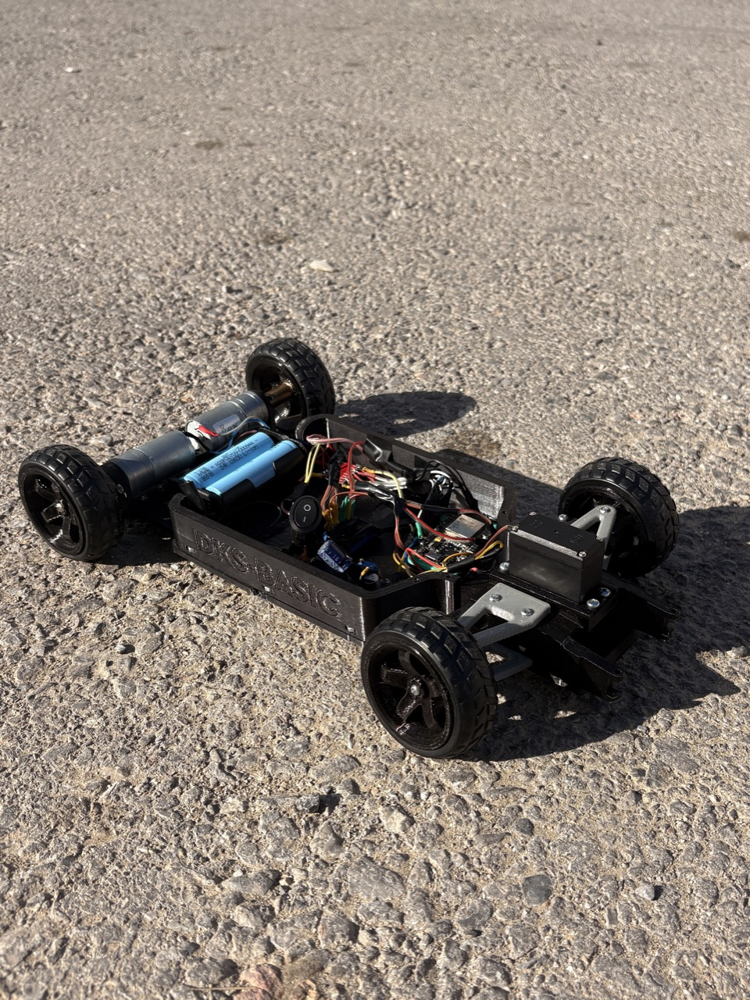
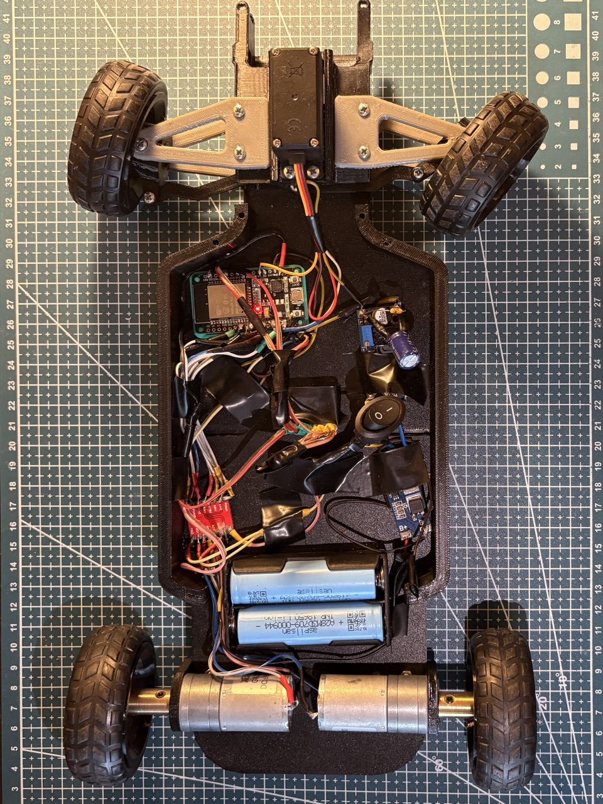
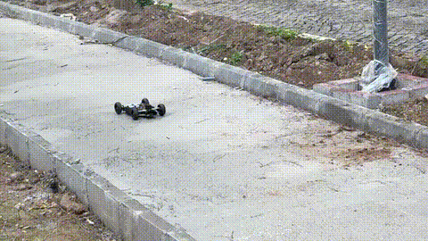

# 🚗 RC-Car-ESP32-IMU (v1.0)

**ESP32-Powered, FreeRTOS Dual-Core, Ackermann-Steered RC Vehicle with 6-DOF IMU Telemetry & Traction Control (TCS)**

An end-to-end embedded Drive-by-Wire vehicle and telemetry platform built from scratch on a customized 1:10 scale 3D-printed chassis using an **ESP32**, **TB6612FNG**, **MG995 Servo**, and **MPU6050 (6-DOF IMU)**.

The vehicle creates its own standalone Wi-Fi Access Point (**`VDT-Car`**) and hosts an embedded mobile touch cockpit over **HTTP + full-duplex WebSockets**, enabling low-latency smartphone driving, real-time 6-DOF IMU telemetry streaming, and an **IMU-based Traction Control System (TCS)** with zero external apps, laptops, or internet dependencies.

---

## 📸 Gallery & Driving Demo

<div align="center">
<table>
  <tr>
    <td align="center" width="33%">
      
      <br/>
    </td>
    <td align="center" width="33%">
      
      <br/>
    </td>
    <td align="center" width="33%">
      
      <br/>
      <sub><b>Driving Demo</b></sub>
    </td>
  </tr>
</table>
</div>

---

## ✨ Key Engineering Features

### 1. 🧠 FreeRTOS Dual-Core Task Isolation
To prevent network traffic from introducing jitter into motor control or safety watchdogs, the ESP32's two CPU cores are strictly isolated:
- **Core 0 (Networking & Telemetry):** Hosts the Wi-Fi SoftAP (`VDT-Car`), HTTP Web Server (`:80`), WebSocket Server (`:81`), and **20 Hz** outbound telemetry broadcasts ([wifi_service.cpp](software/src/wifi_service.cpp)).
- **Core 1 (Real-Time Control & Sensing):**
  - `vehicleTask` (**Priority 2**): Sole owner of motor PWM and steering servo hardware, running the Traction Control filter and **500 ms** Watchdog / Fail-Safe loop ([main.cpp](software/src/main.cpp)).
  - `imuTask` (**Priority 1**): Samples the MPU6050 sensor at a deterministic **100 Hz** (`vTaskDelayUntil`) without starving the motor control task.
- **Lock-Free Inter-Core Queues:** Cross-core data transfer uses 1-element FreeRTOS mailboxes (`commandQueue`, `imuQueue`, `tcsStatusQueue`) via `xQueueOverwrite`, `xQueueReceive`, and `xQueuePeek` to eliminate race conditions and always prioritize the freshest sample.

### 2. ⚡ 3-Layer IMU-Based Traction Control (TCS)
Without wheel encoders, a dedicated 3-layer control module ([traction_control.cpp](software/src/traction_control.cpp)) compares driver throttle/steering inputs against live physical vehicle dynamics (`ax`, `ay`, `gz`) from the MPU6050:
1. **Layer 1 — Launch Slew-Rate Control:** Smoothly ramps upward throttle (`+2%` per cycle) during sudden `0% ➔ 100%` inputs to prevent takeoff wheelspin, while passing throttle cuts, braking, and reverse instantaneously with zero delay.
2. **Layer 2 — Cornering Spin & Oversteer Protection:** Dynamically scales down maximum allowed throttle as steering angle increases (`50%` cap at `±29°` full lock). If excessive yaw rate (`|gz| > 100°/s`) or lateral acceleration (`|ay| > 0.30g`) is detected mid-corner, throttle is automatically clamped to `40%` to prevent spin-out.
3. **Layer 3 — Straight-Line Wheelspin Detection & Progressive Recovery:** When high throttle (`≥ 55%`) produces insufficient forward acceleration (`ax < 0.08g`, indicating wheelspin in place), TCS drops the throttle cap to `45%` until traction returns, then recovers progressively (`+1%` per cycle).
- Includes an on-screen **`TCS: ON / OFF`** toggle button for real-time A/B testing and an amber **`⚡ TCS ACTIVE`** warning indicator.

### 3. 📐 Calibrated Pro-Ackermann Steering Geometry
Front steering linkage geometry was physically measured and mapped into firmware ([steering.cpp](software/src/steering.cpp), [docs/vehicle_params.md](docs/vehicle_params.md)) so the inner front wheel turns at a sharper angle than the outer wheel during cornering:
- **Front Track Width ($T$):** `165 mm` | **Wheelbase ($L$):** `253 mm` ($T/L = 0.652$)
- At full lock, the inner wheel turns **45°** while the outer wheel turns **13°–20°**, minimizing tire scrub in tight turns.
- To prevent mechanical binding and servo stall current spikes, a `4°` software safety margin is enforced from physical hard stops (`38°–125°`, center trim `84°`), and a piecewise linear lookup table provides **`±29.0°`** of symmetric effective wheel travel.

### 4. 📱 Embedded Mobile Web Cockpit & 3-Layer Fail-Safe
- The HTML5/CSS3/JS dual-touch virtual joystick dashboard is served directly from ESP32 Flash (`PROGMEM`) with zero external CDN dependencies.
- **3-Layer Safety Architecture:**
  1. Immediate motor cutoff on WebSocket disconnect (`WStype_DISCONNECTED`).
  2. **500 ms Heartbeat Watchdog:** Automatically triggers `vehicle.emergencyStop()` (zero throttle + centered steering) if no packet arrives within 500 ms.
  3. Strict input clamping (`DriveCommand::validate()`) within `[-100, 100]` throttle and `[-29°, +29°]` steering.

---

## 🖨️ 3D-Printed Chassis & Custom Mechanical Modifications

All structural and drivetrain parts are 3D-printed (PLA chassis/rims and flexible TPU tires). Printable `.stl`, `.3mf`, and editable `.step` CAD files are located in **[Car Chassis Parts/](Car%20Chassis%20Parts)**:

- [`VDT Car Chassis.step`](Car%20Chassis%20Parts/VDT%20Car%20Chassis.step) — Complete assembled CAD model
- [`chassis front.stl`](Car%20Chassis%20Parts/chassis%20front.stl) — Front axle and Ackermann steering housing
- [`chassis back.stl`](Car%20Chassis%20Parts/chassis%20back.stl) — Custom-redesigned rear chassis section
- [`rwd motor mount.stl`](Car%20Chassis%20Parts/rwd%20motor%20mount.stl) — Custom dual DC motor rear mount
- [`3d-bearrings.3mf`](Car%20Chassis%20Parts/3d-bearrings.3mf) — 3D-printed bearing and wheel hub components

### 🛠️ Base Design & Custom Engineering Modifications
The chassis builds upon the **[Chassis 1/10 Adaptable - DKS Basic](https://makerworld.com/en/models/1468804-chassis-1-10-adaptable-dks-basic)** model on MakerWorld, with significant custom CAD redesigns tailored to our dual-motor drivetrain and electronics:
1. **Custom Dual-Motor Rear-Wheel-Drive (RWD) Architecture:** Replaced the original single-motor transmission layout by designing a brand-new rear chassis deck ([`chassis back.stl`](Car%20Chassis%20Parts/chassis%20back.stl)) and a custom dual motor mount ([`rwd motor mount.stl`](Car%20Chassis%20Parts/rwd%20motor%20mount.stl)) to drive the left and right rear wheels independently via two geared DC motors.
2. **Front Steering & MG995 Servo Adaptation:** Modified the front steering assembly to accommodate a high-torque metal-gear MG995 servo and calibrated Ackermann tie-rod geometry.
3. **Electronics & Center-of-Gravity (CoG) Packaging:** Optimized deck layout for the 2S Li-Ion battery pack, LM2596 buck converter, TB6612FNG driver, ESP32, and vibration-damped MPU6050 IMU mounted near the vehicle's Center of Gravity.

---

## 🔌 Hardware Stack & Pinout Summary

| Component | Role | Interface / Specs |
|---|---|---|
| **ESP32 DOIT DevKit V1** | Main ECU & Wi-Fi SoftAP | 240 MHz Dual-Core Xtensa LX6, FreeRTOS |
| **TB6612FNG** | Dual H-Bridge Motor Driver | `20 kHz` 8-bit hardware LEDC PWM |
| **2× Geared DC Motors** | Rear-Wheel Propulsion (RWD) | Channel A (Right), Channel B (Left, software-inverted) |
| **MG995 Servo** | Front Ackermann Steering | `50 Hz` 16-bit hardware LEDC PWM (`GPIO 4`) |
| **MPU6050 (GY-521)** | 6-DOF Accelerometer & Gyroscope | I2C `400 kHz` (`SDA: GPIO 21`, `SCL: GPIO 22`), `±4g`, `±500°/s`, `42 Hz` DLPF |
| **2S 18650 Li-Ion + BMS + LM2596** | Power Distribution | `7.4V–8.4V` motor rail (`VM`), `5.0V` regulated logic/servo rail |

See [docs/pinout.md](docs/pinout.md) for the complete GPIO pin assignment table.

---

## 📁 Repository Structure

```
RC-Car-ESP32-IMU/
├── assets/                     # Vehicle photos (pic1, pic2) and driving demo (video1)
├── Car Chassis Parts/          # 3D-printable meshes (.stl, .3mf) and CAD assembly (.step)
├── docs/
│   ├── pinout.md               # ESP32 GPIO pinout matrix
│   ├── protocol.md             # WebSocket JSON command & telemetry protocol
│   ├── vehicle_params.md       # Ackermann geometry & servo calibration lookup table
│   └── ROADMAP.md              # V1.0 summary & V2.0 future architecture roadmap
├── software/
│   ├── include/                # Modular C++ headers (SOLID & KISS)
│   │   ├── pins.h
│   │   ├── protocol.h
│   │   ├── motor_driver.h
│   │   ├── servo_driver.h
│   │   ├── steering.h
│   │   ├── vehicle_controller.h
│   │   ├── imu_driver.h
│   │   ├── traction_control.h
│   │   └── wifi_service.h
│   └── src/                    # Driver implementations & FreeRTOS tasks
│       ├── main.cpp
│       ├── motor_driver.cpp
│       ├── servo_driver.cpp
│       ├── steering.cpp
│       ├── vehicle_controller.cpp
│       ├── imu_driver.cpp
│       ├── traction_control.cpp
│       └── wifi_service.cpp
├── platformio.ini              # PlatformIO build & library configuration
└── README.md
```

---

## 🚀 Getting Started

### 1. Build & Flash Firmware
Use [PlatformIO](https://platformio.org/) (VS Code extension or CLI) to build and upload the firmware:
```bash
# Compile firmware
pio run

# Upload to ESP32
pio run -t upload

# (Optional) View live serial diagnostics at 115200 baud
pio device monitor
```

### 2. Connect & Drive
1. Power on the vehicle and keep it stationary for **~1 second** while the MPU6050 completes automatic startup gyro bias calibration.
2. Connect your smartphone to the **`VDT-Car`** Wi-Fi network (open, no password).
3. Open Safari or Chrome and navigate to **`http://192.168.4.1`**.
4. Drive using the left virtual joystick (Throttle) and right virtual joystick (Steering), and toggle **`TCS: ON / OFF`** to test Traction Control intervention live!

---

## 📚 Additional Documentation
- [ESP32 Pinout Matrix](docs/pinout.md)
- [WebSocket Communication Protocol](docs/protocol.md)
- [Vehicle & Ackermann Calibration Parameters](docs/vehicle_params.md)
- [Project Roadmap (V1.0 & V2.0)](docs/ROADMAP.md)
